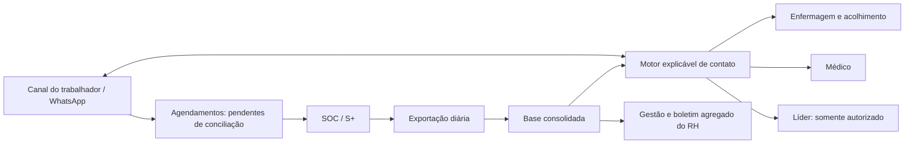

# Painéis da solução — referência de 14/11/2026

Status: requisitos recebidos e análise de aderência ao protótipo. Este documento não declara funcionalidades futuras como implementadas.

Fontes: resumo fornecido pelo usuário nesta conversa e anexo “Prêmio da equipe de saúde: regra detalhada”. O [artefato editável](https://claude.ai/artifact/BRFaMPBLGpM7oPKzKct3En) não pôde ser consultado automaticamente; conteúdo adicional deve ser conciliado quando estiver disponível. A proposta original do prêmio está preservada em [premio-equipe-saude.md](premio-equipe-saude.md).

## Decisões e propostas

| Assunto | Diretriz recebida | Situação no projeto |
| --- | --- | --- |
| Integração | SOC/S+ por exportação diária; WhatsApp em tempo real; agendamentos retornam ao SOC | Requisito novo, depende de layout e acesso aos serviços |
| Base | Base consolidada, em lugar de “data lake” | Arquitetura alvo; banco atual é MySQL |
| Trabalhador | Canal próprio, check-ins, consentimentos e resgate voluntário | Espaço individual existe; estes novos fluxos não existem |
| Líder | Lista estritamente autorizada e participação agregada | Perfil e autorização específica ainda não existem |
| RH | Boletim agregado; mínimo proposto de 10 pessoas | Agregado atual suprime abaixo de 5; novo limiar pendente |
| Médico | Resumo/carteira; entrada principal: risco confirmado e retorno | Resumo e carteira existem; risco e protocolo precisam de modelo próprio |
| Trabalhador: benefício | Elegibilidade semestral; empresa escolhe benefício | Decisão recebida; diferente dos atuais pontos simbólicos 10/20/30 |
| Equipe de saúde | Reconhecimento coletivo baseado em retorno no prazo | Proposta em discussão; não autoriza pagamento ou substituição automática dos pontos individuais |
| Segurança | Arquitetura pós-quântica e gestão pseudonimizada | Decisão de arquitetura recebida, implementação e evidências pendentes |

A gamificação opcional por empresa e os 30 pontos do médico após 180 dias continuam descritos em seus documentos atuais. A relação entre esses pontos e o prêmio coletivo depende da decisão sobre substituição ou coexistência. Nenhuma das propostas monetárias equivale a uma obrigação de pagamento gerada pelo software.

## Fluxo alvo e atualização

Cada painel deve informar a última carga do SOC, o último evento do canal e eventuais pendências de conciliação. Um evento recente do WhatsApp não torna o retrato diário do SOC atualizado. Agendamento fica “aguardando retorno ao SOC” até confirmação da integração; não se deve mostrar sucesso de gravação externa sem comprovante.

Importação: contrato de colunas/versionamento, identificador estável por empresa e pessoa, origem, data do fato, data da extração e da ingestão. Lotes precisam de validação, quarentena de erros, contagem de aceitos/rejeitados, deduplicação e reprocessamento idempotente. Divergências devem ir à conciliação, sem apagar informação clínica ou substituir um risco confirmado por informação administrativa.

WhatsApp: validar assinatura e identidade do webhook, evitar duplicatas, registrar consentimento e entrega e enviar mensagem neutra sem diagnóstico, risco ou referência que revele seleção por doença. Bloqueio e revogação interrompem novos contatos opcionais. Ainda são necessários provedor, credenciais, modelos e contrato de retorno ao SOC.

## Painéis: mínimo de cliques

| Painel | Conteúdo principal | Ação direta |
| --- | --- | --- |
| Enfermagem / acolhimento | Fila do dia, ficha de 30 segundos, última tentativa e próximo passo, agenda/encaixe, situação da exportação SOC | Abrir ficha e registrar contato na própria fila; salvar e ir ao próximo |
| Trabalhador no celular | Próximo atendimento, confirmar/remarcar, check-in com “consegui / não consegui”, pedir ajuda, consentimentos e código de resgate | Uma ação por cartão; não exigir texto para “não consegui” |
| Gestão SESI | Funil, participação/adesão/risco separados, operação, faltas, implantação escalonada, valor e “Como medimos” | Abrir detalhamento agregado, mantendo período e unidade |
| Líder | Nome/horário autorizados, contato perdido autorizado, participação agregada e kit do líder | Confirmar apoio operacional sem acessar prontuário |
| Médico | Resumo antes da consulta, carteira e retornos devidos | Confirmar risco e data do retorno no contexto do paciente |

As ações clínicas existentes não devem ser removidas apenas para reduzir cliques. Entrada rápida do médico preenche somente risco confirmado e data do retorno para o novo fluxo, mantendo autoria e acesso ao prontuário. Não inferir risco de faltas, check-ins, pontos ou participação em campanha.

Acolhimento tem escopo administrativo; enfermagem tem escopo assistencial conforme habilitação. Estar na mesma equipe não concede ao acolhimento permissão para ler notas clínicas. Líder é um novo perfil operacional e não um gestor empresarial com acesso amplo.

## Consentimento e proteção contra exposição

Autorizações separadas para líder, pessoa de apoio e programa de benefício, com texto/versionamento, finalidade, destinatário, dados permitidos, validade, aceite e revogação. Participar do cuidado não exige aceitar o benefício ou avisar o líder.

O backend revalida autorização a cada leitura e antes de cada envio. Uma revogação retira a pessoa das listas e cancela notificações ainda não enviadas. Exportações devem ter finalidade, destinatário e validade; não permitir listas persistentes de líder que ignorem revogação. Também é sensível revelar apenas que a pessoa integra um programa para casos selecionados.

A lista do líder contém só nome, horário e aviso operacional autorizados. Nunca risco, diagnóstico, prontuário, motivo clínico, pontos individuais ou situação de adesão. O RH recebe agregado e valida código voluntariamente apresentado, sem receber a lista de inelegíveis ou o motivo de não elegibilidade.

O mínimo de 10 é uma proposta para o boletim. O desenho também precisa suprimir células complementares, diferenças entre totais e filtros sucessivos que permitam reidentificação; retirar nomes não basta. A gestão pseudonimizada continua sujeita à LGPD.

## Elegibilidade semestral do trabalhador

Adesão opcional pela empresa e consentimento específico do trabalhador. Pré-condição institucional: consulta APS não retira prêmio de assiduidade.

A elegibilidade exige conjuntamente:

1. Comparecimento ou remarcação com antecedência mínima de 24 horas.
2. Retorno no prazo do risco confirmado.
3. Resposta a pelo menos três de quatro check-ins; “não consegui” vale como resposta.

Resultado de saúde, quantidade de consultas e status de adesão ficam fora da fórmula. O benefício é escolhido pela empresa. Sugestões recebidas: folga no aniversário de familiar, saída antecipada, prioridade nas férias, vale-compras/lazer familiar ou melhoria escolhida pelo setor. Não há benefício isolado ao líder. Ele participa do reconhecimento da sua equipe como integrante; isso não o transforma em profissional de saúde nem lhe dá acesso à carteira assistencial. A associação entre equipe do setor, equipe de referência de saúde e respectivos programas deve ser explícita.

Ao ser elegível, o trabalhador recebe código aleatório e decide apresentá-lo ao RH. Implementar validade, escopo da empresa/semestre, uso único, armazenamento não recuperável do código e trilha de resgate; o resgate não revela evidências clínicas.

Pontos a fechar antes do cálculo: semestre civil ou janela móvel; trabalhador que ingressa no meio do período; ausência de retorno devido; erro de agenda; cancelamento do serviço; limite da remarcação; exceções documentadas; quando cada check-in é enviado; contestação e evidência insuficiente. Dado ausente deve produzir “não apurável”, sem presumir falta ou recusa.

## Reconhecimento da equipe — simulação em discussão

A proposta completa permanece em [premio-equipe-saude.md](premio-equipe-saude.md). Indicador: retornos no prazo divididos pelos retornos devidos. Carteira e risco congelados no primeiro dia; exclusões posteriores somente com fonte objetiva e trilha. Contato perdido e recusa por telefone permanecem no denominador.

O painel SESI terá uma linha por equipe com período, devidos originais, exclusões justificadas, denominador final, retornos no prazo, RP, linha de base, ganho em pontos percentuais, faixa simulada e estado das travas. Não misturar RP com adesão ou resultado clínico.

Mínimo proposto de 300 devidos: trimestre; se insuficiente, semestre; depois regional. Não converter amostra insuficiente em prêmio zero ou pagamento aprovado. Congelamento, exclusões, agrupamento regional e linha de base precisam de versões e memória de cálculo.

Ganho: [4,6) pp → 1%; [6,8) → 2%; [8,10) → 3%; [10,12) → 4%; ≥12 → 5%. Abaixo de 4 → 0%. Excelência de 80% é sugestão a calibrar, assim como tolerância de 15 dias. Classificação usa valores sem arredondamento, arredondando só a exibição.

Protocolo recebido para a simulação: riscos 1 e 2 → seis meses; risco 3 → três meses; risco 4 → data definida pelo médico. Confirmar a versão institucional do protocolo, cálculo de meses de calendário e associação entre consulta e retorno devido antes de automatizar. A tolerância de 15 dias do prêmio coletivo não se aplica automaticamente à elegibilidade do benefício do trabalhador.

Travas: satisfação ≥90%, nenhuma queixa de pressão procedente, auditoria quando rebaixamentos/exclusões superam 1,5 vez a média e respeito à autorização de contato. Dado ausente ou auditoria pendente bloqueiam aprovação; não equivalem a uma trava aprovada.

Percentuais salariais, alternativa de fundo e pagamento ficam sujeitos à aprovação institucional e jurídica. O protótipo não realiza folha ou transferência financeira. Percentuais de probabilidade, satisfação atual de 96% e custos citados no anexo são alegações recebidas, não resultados medidos pelo sistema.

## Gestão e “Como medimos”

Cada indicador exibe definição, numerador, denominador, período, origem, atualização, exclusões, cobertura, versão da regra e limitação. Participação mede alcance/resposta; adesão mede execução pactuada; resultado de risco usa somente risco confirmado e comparável. Benefício não depende do resultado clínico ou status de adesão.

Comparação por implantação escalonada deve registrar grupo/unidade e data de entrada, período anterior e posterior, composição e incerteza. Não chamar diferença observada de efeito causal sem desenho e análise adequados.

A fórmula de valor não veio especificada. Proposta para discussão: custo incremental por retorno adicional estimado, com custos explícitos e comparação válida. Se o ganho estimado for zero/negativo ou não identificável, mostrar “não estimável”. Não anunciar ROI, economia ou R$ 42 por vida como preços comprovados. Valores do anexo são fictícios.

## Sequência e critérios de aceite

1. **Enfermagem:** contrato de importação/conciliação e ficha rápida; teste com lote repetido, inválido e atrasado; sem exposição clínica ao acolhimento.
2. **Trabalhador:** canal móvel, check-ins, autorizações revogáveis e ajuda; teste de duplicidade, identidade e nenhuma autorização pré-marcada.
3. **Gestão:** métricas com denominadores e cobertura; boletim mínimo proposto de 10 com proteção contra diferenças; simulação do prêmio claramente identificada.
4. **Líder:** novo perfil por empresa/unidade; nenhum dado sem autorização vigente; teste de revogação entre leitura e envio.
5. **Médico:** risco confirmado versionado e retorno; carteira devida rastreável; data clínica nunca inferida de pontuação.
6. **Segurança:** implantação verificável por trecho, migração e recuperação; tela opcional mostra somente controles comprovados.

A segurança acompanha todas as fases; a tela opcional não substitui sua implementação. Layout SOC, contrato do provedor WhatsApp, confirmação do protocolo de risco, governança de consentimento e regulamento de benefícios são dependências de integração, não motivos para paralisar a preparação local.

## Segurança: alvo versus implementação

| Controle | Hoje | Alvo recebido / evidência necessária |
| --- | --- | --- |
| Banco | PDO MySQL; migrações MySQL e testes SQLite/MySQL | PostgreSQL 18 exige projeto de migração, compatibilidade e recuperação; não é simples troca de configuração |
| Campos clínicos | AES-256-GCM com APP_KEY externa ao banco | Envelope com chaves por versão, custódia externa, combinação híbrida definida e rotação recuperável |
| Trânsito | TLS depende de cada implantação; desenvolvimento local HTTP | TLS 1.3 com X25519MLKEM768; verificar cliente, terminador, origem e banco separadamente |
| Auditoria | Registros de aplicação sem encadeamento ou assinatura pós-quântica | Sequência encadeada e assinatura ML-DSA, custódia de chave, verificador e âncora externa contra truncamento |
| Arquivo SOC | Integração não implementada | Cifra autenticada, encapsulamento híbrido, assinatura, destinatário e proteção contra reenvio |
| Gestão | Agregação com limiar atual 5 | Base pseudonimizada, acessos separados e boletim com limiar aprovado |

ML-KEM é mecanismo de encapsulamento de chave, não algoritmo para cifrar diretamente arquivo grande; usar a chave derivada em cifra autenticada. A escolha de grupo híbrido de troca não torna automaticamente certificados, assinaturas, backup e todos os trechos pós-quânticos. Não implementar primitivas próprias.

O WhatsApp fica fora dessa garantia de infraestrutura: reduzir conteúdo, manter mensagens neutras e controlar acesso ao canal. A demo pública permanece fictícia e somente para consulta; seletor sem senha não é autenticação adequada para dados reais.

## Referências verificadas e limites

- [NIST IR 8547 final](https://csrc.nist.gov/pubs/ir/8547/final), publicado em 27/10/2026: roteiro de transição de algoritmos vulneráveis a computadores quânticos. Os marcos de 2030/2035 pertencem às normas/diretrizes NIST, sem constituir proibição legal brasileira automática.
- [PostgreSQL 18: conexões e autenticação](https://www.postgresql.org/docs/18/runtime-config-connection.html): parâmetro ssl_groups e dependência da biblioteca TLS.
- [OpenSSL 3.5: SSL_CONF_cmd](https://docs.openssl.org/3.5/man3/SSL_CONF_cmd/): suporte a grupos híbridos, incluindo X25519MLKEM768.
- [LGPD, art. 11](https://normas.leg.br/?urn=urn%3Alex%3Abr%3Afederal%3Alei%3A2018-08-14%3B13709%21art11): tutela da saúde tem escopo próprio; compartilhamentos opcionais com empregador exigem análise específica, minimização e consentimento destacado quando essa for a base adotada.

O mapeamento legal definitivo depende do controlador e do jurídico SESI. A referência à SC Cosit 10/2026 foi preservada como parte da proposta; seu texto oficial e o enquadramento concreto não foram validados nesta análise.
